<div align="center">

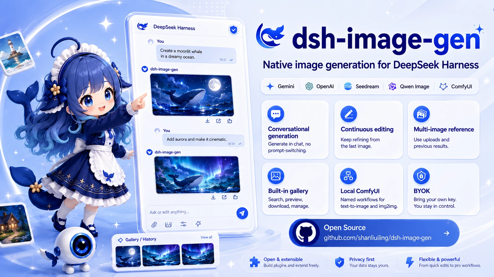

<br />

<p><a href="README.md">简体中文</a> · <strong>English</strong></p>

# 🎨 dsh-image-gen

### Draw by talking, right inside DeepSeek Harness

<p><b>Batch generation from one message · A canvas the AI can actually read · Agent-picked prompts from 500+ examples · Subscription sign-in, no API key</b></p>

<p>
  <a href="https://www.npmjs.com/package/dsh-image-gen"></a>
  <a href="https://www.npmjs.com/package/dsh-image-gen"></a>
  <a href="https://github.com/shanliuling/dsh-image-gen/actions/workflows/ci.yml"></a>
  <a href="https://dsh-insights.com/p/shanliuling/dsh-image-gen"></a>
  <a href="https://github.com/shanliuling/dsh-image-gen/stargazers"></a>
  <a href="LICENSE"></a>
  <a href="https://linux.do/"></a>
</p>

<p>
  <a href="https://atomgit.com/shanliuling/dsh-image-gen"></a>
</p>

<p>
  <a href="#just-say-it">Just say it</a> ·
  <a href="#quick-start">Quick Start</a> ·
  <a href="#core-capabilities">Core Capabilities</a> ·
  <a href="#provider-support">Provider Support</a> ·
  <a href="#faq">FAQ</a>
</p>

<br />

<table>
  <tr>
    <td width="50%" align="center"><b>🔁 One message, a whole set</b><br /><sub>5 scenes in one message, generated one by one</sub></td>
    <td width="50%" align="center"><b>✏️ Sketch it, circle it, done</b><br /><sub>Circle the sword → an axe · stick figure → finished art</sub></td>
  </tr>
  <tr>
    <td><a href="#chat-batch">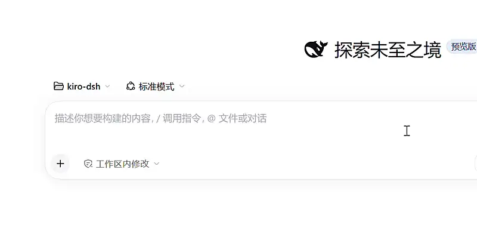</a></td>
    <td><a href="#ai-canvas">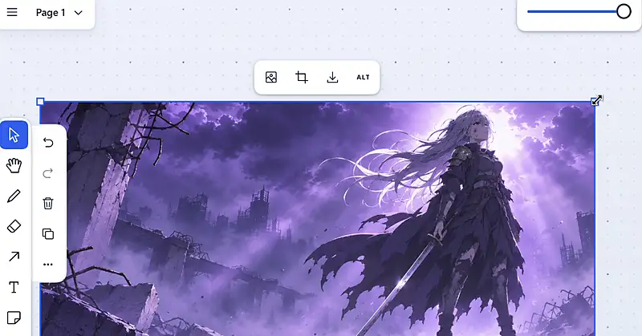</a></td>
  </tr>
</table>

</div>

<br />

`dsh-image-gen` is a native image creation plugin for DeepSeek Harness. Instead of bolting an image button onto the chat, it **teaches the Agent itself to make images**: it can plan and generate a whole set in one go, read your sketches and selections on the canvas, and pull the right style template from the inspiration library on its own. When you want fine-grained control, Studio, multi-model comparison, and the Gallery are one click away.

> **Already paying for ChatGPT, Grok, or Google? Just sign in and start generating—no separate API key purchase needed.**

Supports: Gemini · OpenAI / Compatible · Seedream · DashScope · Grok Imagine · GLM-Image · Local ComfyUI

```bash
pnpm dsh plugin --profile web add dsh-image-gen@latest
```

> See [Releases](https://github.com/shanliuling/dsh-image-gen/releases) for what changed in each version.

---

## Just say it

No parameters to learn, no pages to switch. Just say it in a DSH chat:

| You say | What the plugin does |
| :-- | :-- |
| "Make 4 illustrations for my *Coffee Shop Grand Opening* post, consistent flat style, 16:9" | 🔁 **Batch generation in chat**: the Agent splits the request into 4 prompts and generates them one by one, all delivered in a single reply |
| "Draw a coffee shop menu in hand-drawn style #123" | ✨ **Inspiration on autopilot**: the Agent searches the 500+ example library for that style, then applies the template |
| "Turn the sketch I drew on the canvas into a finished illustration" | ✏️ **Reads the canvas**: the Agent looks at your canvas selection and turns the draft into an image |
| "Turn the sword I circled into an axe, keep everything else" | 🎯 **Edit what you circle**: only the marked area changes |
| "Keep this character exactly the same, but put them in a snowy scene" | 🎭 **Identity consistency**: edits keep the same person or object instead of a lookalike |
| "Same prompt, one from GPT and one from Gemini, side by side" | ⚖️ **Multi-model comparison**: runs several models concurrently and lays the results out on one canvas |


---

## Quick Start

### 1. Install the plugin

Requirements: DeepSeek Harness stable version, Node.js `^22.19.0` or `>= 24.0.0`.

Run this command from your DeepSeek Harness project root:

```bash
pnpm dsh plugin --profile web add dsh-image-gen@latest
```

> 💬 **Power-user tip:** You can also send this directly to the Agent in a DSH chat:<br />
> `Install the image generation plugin by running this command in the terminal: pnpm dsh plugin --profile web add dsh-image-gen@latest`

<details>
<summary><strong>Alternative installation methods (global / GitHub / local development)</strong></summary>

```bash
# If dsh is installed globally:
dsh plugin --profile web add dsh-image-gen@latest

# Install the latest source directly from GitHub:
pnpm dsh plugin --profile web add git+https://github.com/shanliuling/dsh-image-gen.git

# Clone the repository and install it for local development:
git clone https://github.com/shanliuling/dsh-image-gen.git
pnpm dsh plugin --profile web add ./dsh-image-gen
```

</details>

### 2. Configure a Provider

After restarting DSH, click the **Plugins** icon in the left sidebar, then click **dsh-image-gen** under **Installed** — the Image Generation settings form lives on the plugin's detail page:

**Plugins panel → Installed → dsh-image-gen**

> DSH 0.1.5 and earlier have no Plugins panel; the entry there is **Settings → Plugins → Plugin Configuration → Image Generation**. The same plugin build supports both.

Choose a Provider, enter your API key, and adjust the model, Endpoint / Base URL, and workspace-save options as needed. Once the key is stored, click **Test connection** to verify it, or **Fetch models** to pull every image-capable model the provider offers—no manual lookups needed. For ComfyUI, enter an address reachable by the DSH Host and import an **API Format Workflow JSON** file.

Already paying for ChatGPT, Grok, or Google? No API key needed: expand the matching subscription Provider row, click **Sign in** and complete the authorization in your browser, then start generating (and editing) right away.

<div align="center">
  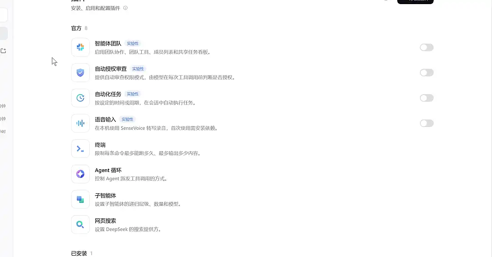
  <br />
  <sub>Pick a default Provider → check each channel's key / sign-in status → switch channels right from the chat input.</sub>
</div>

### 3. Start creating

Describe the image you want directly in chat:

```text
Create a cinematic cyberpunk cat on a neon street at night, 16:9.
```

Want a whole set? Just say how many and what should stay consistent:

```text
Make 5 images for my "Weekend Camping Checklist" post: tent, stove, sleeping bag, lights, snacks. Consistent Japanese hand-drawn style, 3:4.
```

You can also upload a reference image directly for style transfer or editing:

```text
Keep the character and composition unchanged, then add black sunglasses to the cat.
```

<br />

<div align="center">
  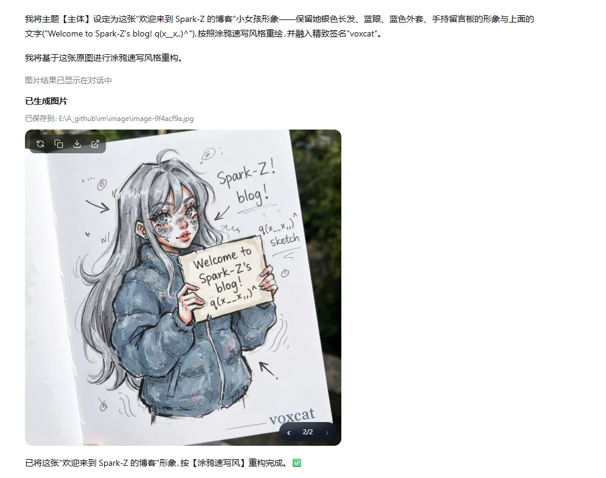
  <br />
  <sub>In-chat generation, editing, and continuous refinement.</sub>
</div>

<br />

For more precise parameter control, open **Gallery** from the conversation header, then switch between **Gallery / Studio / Inspiration / Favorites**.

---

## Core Capabilities

<a id="chat-batch"></a>

### 🔁 Batch generation in chat: one message, a whole set

Post illustrations, storyboards, series art, or several variations on a theme—without asking for them one at a time.

- Describe how many images you want and what they share. The Agent plans the set of prompts itself, **up to 10 images per call**, attached in order to a single reply.
- Aspect ratio, resolution, model, and Provider can be set once for the whole set to keep it consistent.
- Images generate one after another, and **one failure never stops the rest**: the reply reports "X of Y generated" and lists what failed and why.
- Works with local ComfyUI and subscription channels too.

<div align="center">
  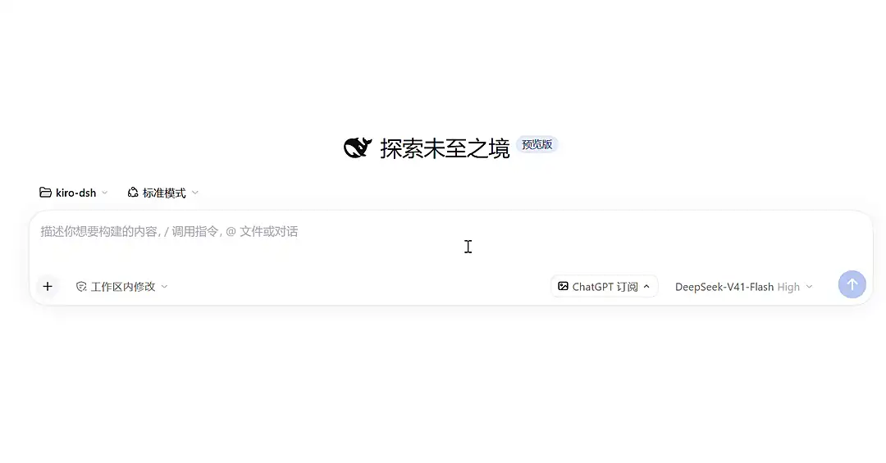
  <br />
  <sub>One message with 5 scenes → the Agent plans two batches → images arrive one by one, the failed one is retried on its own → the whole set lands in the Gallery. (Waiting sped up.)</sub>
</div>

> **How is this different from Studio batches?** Chat batches are a **set of different images** the Agent plans for you (say, 4 illustrations of different scenes). Studio batches are **several candidates for the same prompt**, and you keep the ones you like.

<br />

<a id="ai-canvas"></a>

### ✏️ A canvas the AI can actually read

Sketch on an infinite canvas, lay out references, circle what should change, then just tell the AI what you want. **The Agent sees what is on the canvas and what you have selected**, so there is no need to screenshot, upload, or describe positions.

- **Sketch → image**: draw a rough outline, select it, and say "make this a cartoon character".
- **Edit what you circle**: mark an area on an existing image and say "turn this into an axe"; only the circled part changes.
- **Combine references**: drag images from Recent generations or the Gallery onto the canvas, or click Send to canvas on a thumbnail, then select several together as references. Repeated imports of the same history item are deduplicated.
- Every result stays on the canvas, so you can keep iterating from any version.

<div align="center">
  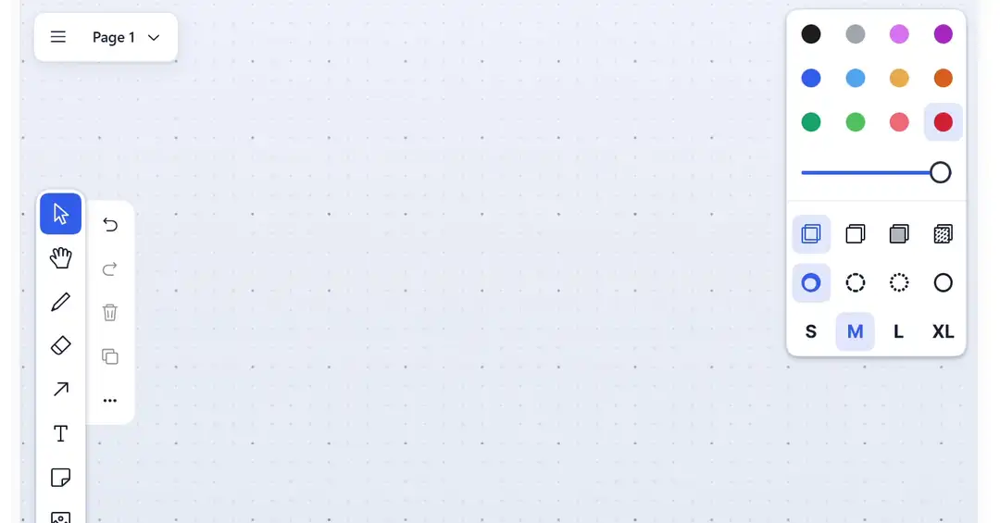
  <br />
  <sub><b>Edit what you circle</b>: circle the swordswoman's blade, ask for an axe, and the Agent confirms what you marked, then changes only that.</sub>
  <br /><br />
  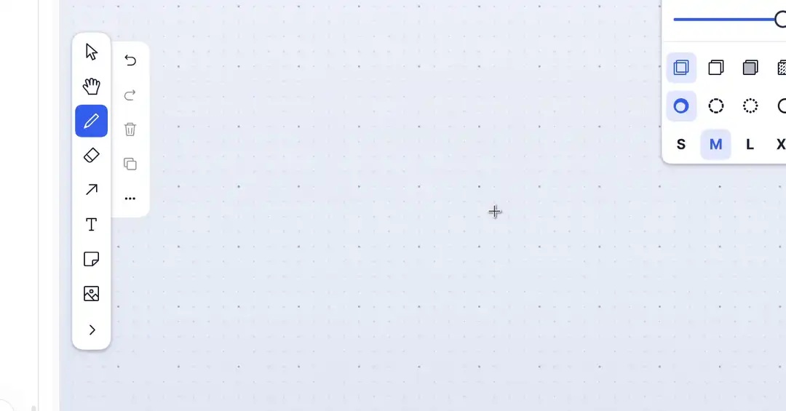
  <br />
  <sub><b>Sketch → image</b>: doodle a stick figure holding a sword, select it, ask for "the previous style", and the pose and framing follow your sketch. (Waiting sped up.)</sub>
</div>

<br />

### 💬 In-chat generation, editing, and revision switching

- Use natural language for text-to-image, image-to-image, multi-image reference, and style transfer.
- **Identity consistency**: when you ask to keep a person, character, or object the same, the plugin tells the model to reuse the subject from the references and change only the scene, clothing, pose, or style, rather than drawing a similar-looking replacement.
- Edit the original prompt to regenerate, then switch between revisions on the same image card.

<br />

<div align="center">
  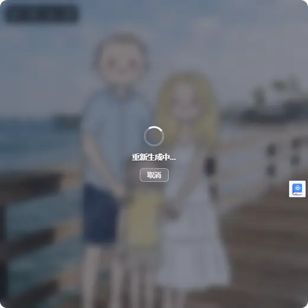
  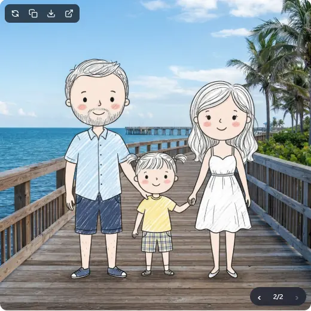
  <br />
  <sub>Regenerate in place after editing the prompt, then switch between previous results on the same image card.</sub>
</div>

<br />

### ✨ 500+ prompt inspirations, and the Agent finds them for you

Ships with a hand-drawn style cookbook (styles / layouts / theme colors) and the awesome-gpt-image-2 example set: 500+ ready-to-reuse prompts.

- **Name it in chat**: say "use style #123", "make it an infographic layout", or "Morandi palette", and the Agent searches the library first, then applies the template to your topic. Styles, layouts, and theme colors can be combined.
- **Browse in the UI**: filter, favorite, copy, or send a prompt straight to Studio (see the Studio demo below).
- Images are cached locally, so browsing and learning consume no tokens or generation quota.

<br />

<div align="center">
  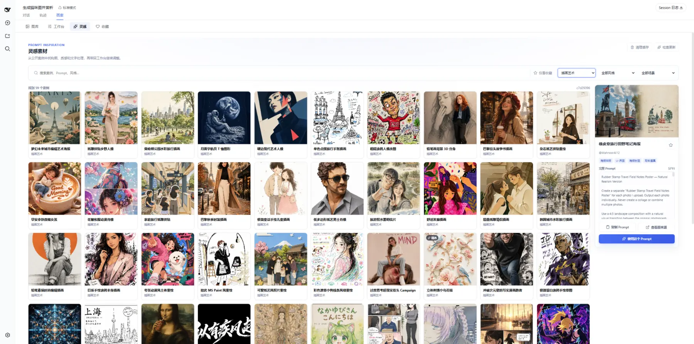
  <br />
  <sub>Find inspiration first, then send a prompt to Studio. Browsing and copying from the local cache consume no generation quota.</sub>
</div>

<br />

### 🎛️ Studio: hands-on control, no chat needed

When you want precise control, open **Gallery → Studio** from the conversation header and every parameter is right there.

- **Start from inspiration**: click "Send to Studio" in the inspiration library and the prompt is filled in.
- **Every parameter in view**: pick the Provider, model, aspect ratio, quality, and watermark separately; generate 1–4 candidates and save only the ones you like.
- **Keep editing past results**: drag an image in from Recent generations and click "Continue editing" to make it the image-to-image reference (up to 5).
- Switch between single model and multi-model comparison in one click.

<br />

<div align="center">
  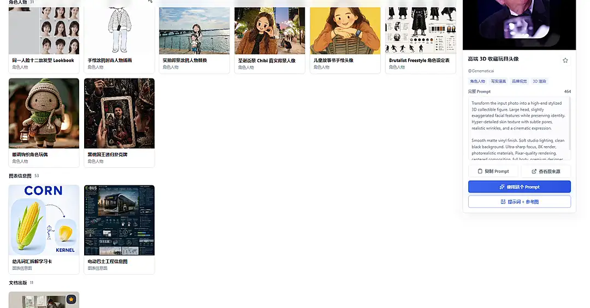
  <br />
  <sub>Pick a prompt from the library → send it to Studio → set parameters and generate → decide what to keep. (Waiting sped up.)</sub>
  <br /><br />
  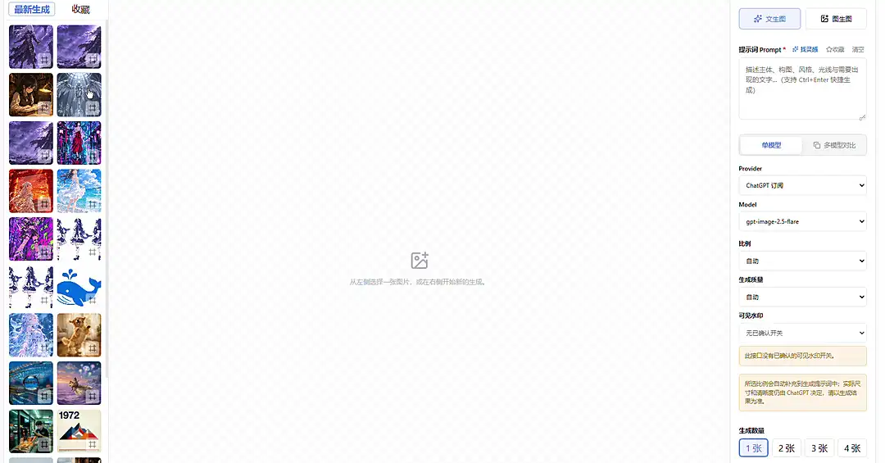
  <br />
  <sub>Drag an image in from Recent generations → "Continue editing" → Studio switches to image-to-image with it as the reference.</sub>
</div>

<br />

### ⚖️ Side-by-side multi-model comparison

Run the same prompt and reference images across multiple models concurrently, then compare and save the results on one canvas.

<br />

<div align="center">
  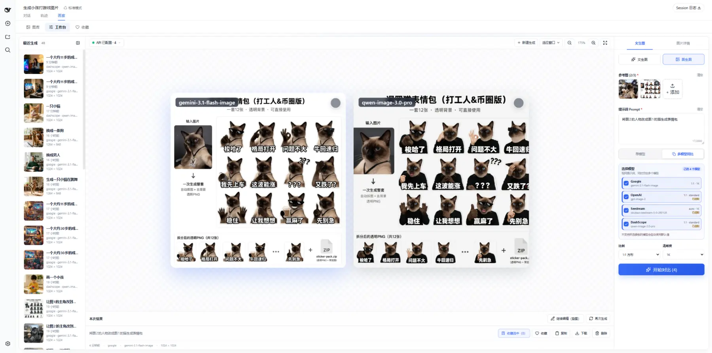
  <br />
  <sub>Compare results from different models on one canvas, then save the images you prefer in a batch.</sub>
</div>

<br />

### 🖼️ Gallery, favorites, and batch management

- Manage images saved from chat and Studio in one place, isolated by workspace.
- Search, filter, favorite, download, continue editing, regenerate, and batch-manage results.

<br />

<div align="center">
  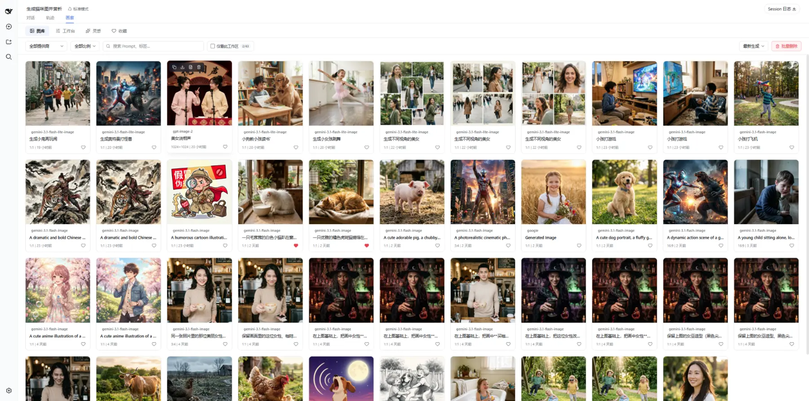
  <br />
  <sub>Filter, favorite, and batch-manage gallery items while keeping data isolated by workspace.</sub>
</div>

<br />

### 🧩 Multiple local ComfyUI workflows

Bring private image generation on your local GPU directly into Agent conversations.

- Import and manage multiple named workflows with prompt presets and common placeholders.
- Let the Agent select a workflow by name for text-to-image, image-to-image, or batch generation in chat.

> ComfyUI is not yet integrated into Studio or multi-model comparison.

<br />

<div align="center">
  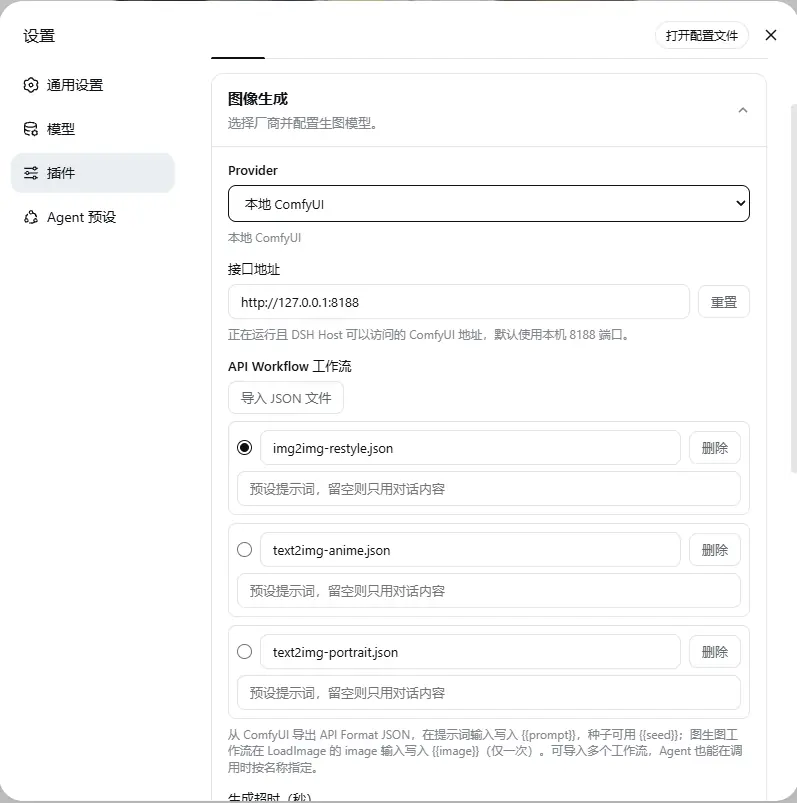
  <br />
  <sub>Maintain independent workflows for different tasks and let the Agent select them precisely by name.</sub>
</div>

<br />

---

## Provider Support

| Provider | Chat generation | Chat batch | Chat editing | Studio | Multi-model comparison |
| :--- | :---: | :---: | :---: | :---: | :---: |
| **Google Gemini** | ✅ | ✅ | ✅ Multiple | ✅ | ✅ |
| **OpenAI Images** | ✅ | ✅ | ✅ Multiple | ✅ | ✅ |
| **OpenAI Compatible (relay)** | ✅ | ✅ | ✅ Multiple | ✅ | ✅ |
| **ByteDance Seedream / Volcengine Ark** | ✅ | ✅ | ✅ Multiple | ✅ | ✅ |
| **Aliyun DashScope / Qwen Image** | ✅ | ✅ | ✅ Multiple | ✅ | ✅ |
| **xAI Grok Imagine** | ✅ | ✅ | ⚠️ Limited | ✅ | ✅ |
| **Zhipu GLM-Image** | ✅ | ✅ | — | ✅ | ✅ |
| **Local ComfyUI** | ✅ | ✅ | ✅ Single | — | — |
| **ChatGPT subscription (key-free)** | ✅ | ✅ | ✅ Multiple | ✅ | ✅ |
| **Grok subscription (key-free)** | ✅ | ✅ | ✅ Multiple | ✅ | ✅ |
| **Google subscription (key-free)** | ✅ | ✅ | ✅ Multiple | ✅ | ✅ |

> Studio and multi-model comparison currently support cloud Providers only (subscription channels included). Multi-model comparison uses the model configured for each Provider in Settings.
> Zhipu GLM-Image does not support image-to-image upstream. xAI image editing goes through the OpenAI-compatible protocol (multipart); some gateways may need further adaptation.
> Subscription channels work through account sign-in (no API key). Edits ride each channel's edit endpoint (up to 5 reference images), with aspect ratio and quality selectable directly in Studio.

📖 **For default models and endpoints, per-Provider aspect ratios and quality tiers, size tables, watermarks, relay edit formats, and other advanced settings, see the [Provider configuration reference](docs/providers.en.md).**

---

## Data and Privacy

- **BYOK:** API keys are stored through the DSH Credentials service and are never displayed in plaintext on the settings page.
- **Subscription sign-in:** Subscription tokens are saved in DSH Credentials after your authorized sign-in, fully isolated from API keys; the browser side never touches a token.
- **Cloud requests:** The prompt and reference images used for a request are sent to the selected Provider. Follow that Provider's terms of service.
- **Local ComfyUI:** Requests are sent to the configured ComfyUI address.
- **Workspace files:** When workspace saving is enabled, chat results are written to disk; Studio saves only the candidates you select.
- **Gallery and favorites:** Gallery metadata and favorite state are stored in the current browser's local storage.
- **Inspiration cache:** Example metadata ships with the plugin. Images load on demand and are cached locally, and the cache can be cleared at any time.

## FAQ

<details>
<summary><strong>What should I do if “Image Generation” is missing after installation?</strong></summary>

The settings entry depends on the DSH version: 0.1.6 and newer place it on the plugin's detail page (click **Plugins** in the left sidebar, then dsh-image-gen under **Installed**), while 0.1.5 and earlier place it at **Settings → Plugins → Plugin Configuration → Image Generation**.

If it is missing in both places, fully restart the current DSH Profile, then inspect the plugin configuration:

```bash
dsh --profile web --dump-config
```

If `dsh-image-gen` is absent from the output, run the installation command again. When filing an issue, include the DSH version, plugin version, and relevant error logs, but never include your API key.

</details>

<details>
<summary><strong>How many images can one batch generate?</strong></summary>

Up to 10 per batch call; beyond that, the plugin tells the Agent to split the request into several calls. Images generate one at a time, a single failure does not stop the others, and any failures are listed with their reasons.

</details>

<details>
<summary><strong>Where are generated images saved?</strong></summary>

When “Save to workspace” is enabled, chat results are saved to the `dsh-image-gen/` subdirectory of the current workspace by default. You can change this directory in Settings. Studio candidates remain on the temporary canvas until you select which results should enter the gallery and be saved.

</details>

<details>
<summary><strong>How do I use a Gemini relay that only supports generateContent?</strong></summary>

In Google Gemini settings, select “Native generateContent” under “Request protocol”, enter the relay's API base URL (for example, `https://your-relay.example/v1beta`), and save. This applies to conversation generation, editing, and Studio. An existing full Interactions URL can also be kept; the plugin builds the native endpoint using the selected model.

The configuration field is `googleNative: true`. It defaults to `false`, keeping existing users on the Interactions protocol.

</details>

<details>
<summary><strong>Why is ComfyUI not available in Studio?</strong></summary>

Studio and multi-model comparison currently support cloud Providers only; ComfyUI is not yet integrated. ComfyUI supports text-to-image, single-image editing, batch generation, and multiple named workflows through Agent chat.

</details>

<details>
<summary><strong>Does deleting an item from the gallery remove its chat message?</strong></summary>

No. Deleting a gallery record does not modify the original chat message. You may separately choose to remove the corresponding local image file from the workspace. File deletion is normally irreversible, so confirm carefully.

</details>

<details>
<summary><strong>How do I upgrade?</strong></summary>

```bash
pnpm dsh plugin --profile web add dsh-image-gen@latest
```

Restart the corresponding DSH Profile after upgrading.

</details>

---

## Local Development

```bash
git clone https://github.com/shanliuling/dsh-image-gen.git
cd dsh-image-gen

pnpm install
pnpm run typecheck
pnpm test
pnpm run build
pnpm run pack:check
pnpm run test:package
```

Maintainer notes on dependency requirements and the scope of `test:package` are in [CONTRIBUTING.md](CONTRIBUTING.md). Feedback is welcome through [Issues](https://github.com/shanliuling/dsh-image-gen/issues); read the contributing guide before opening a Pull Request.

## Acknowledgements

- [AtomGit](https://atomgit.com/shanliuling/dsh-image-gen): Hosts a copy of the project for users in China to browse and download the source code.

## License

This project is open source under the [Apache License 2.0](LICENSE).

<div align="center">

If `dsh-image-gen` improves your workflow, consider giving the project a ⭐ **Star** to support continued maintenance.

**[View Releases](https://github.com/shanliuling/dsh-image-gen/releases) · [Open an Issue](https://github.com/shanliuling/dsh-image-gen/issues) · [Contribute](CONTRIBUTING.md)**

</div>
