<div align="center">

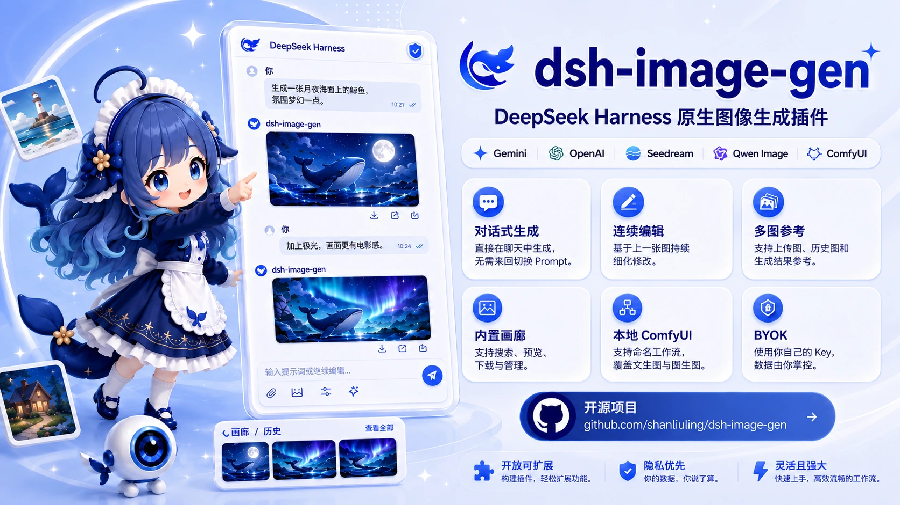

<br />

<p><strong>简体中文</strong> · <a href="README.en.md">English</a></p>

# 🎨 dsh-image-gen

### 在 DeepSeek Harness 里，用说话的方式画图

<p><b>对话批量生图 · 看得懂草图的 AI 画布 · Agent 自动套用 500+ Prompt 灵感 · 订阅账号免 Key</b></p>

<p>
  <a href="https://www.npmjs.com/package/dsh-image-gen"></a>
  <a href="https://www.npmjs.com/package/dsh-image-gen"></a>
  <a href="https://github.com/shanliuling/dsh-image-gen/actions/workflows/ci.yml"></a>
  <a href="https://dsh-insights.com/p/shanliuling/dsh-image-gen"></a>
  <a href="https://github.com/shanliuling/dsh-image-gen/stargazers"></a>
  <a href="LICENSE"></a>
  <a href="https://linux.do/"></a>
</p>

<p>
  <a href="https://atomgit.com/shanliuling/dsh-image-gen"></a>
</p>

<p>
  <a href="#一句话就能做到">一句话就能做到</a> ·
  <a href="#快速开始">快速开始</a> ·
  <a href="#核心能力">核心能力</a> ·
  <a href="#provider-支持情况">Provider 支持</a> ·
  <a href="#常见问题">常见问题</a>
</p>

<br />

<table>
  <tr>
    <td width="50%" align="center"><b>🔁 一句话，一整组图</b><br /><sub>一条消息Agent 批量生成几十张图片</sub></td>
    <td width="50%" align="center"><b>✏️ 画个草图、圈个地方，AI 就懂</b><br /><sub>圈出剑 → 换成斧头 · 火柴人 → 成图</sub></td>
  </tr>
  <tr>
    <td><a href="#chat-batch">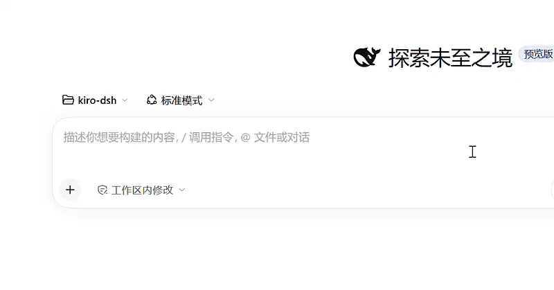</a></td>
    <td><a href="#ai-canvas">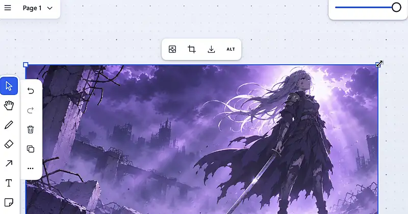</a></td>
  </tr>
</table>

</div>

<br />

`dsh-image-gen` 是 DeepSeek Harness 的原生图像创作插件。它不是在对话框里塞一个生图按钮，而是让 **Agent 本身学会画图**：它能一次规划并生成一整组图，能看懂你在画布上的涂鸦和圈选，能自己去灵感库里找合适的风格模板。需要精细控制时，还有 Studio 工作台、多模型对比和图库。

> **已有 ChatGPT、Grok 或 Google 订阅？直接登录即可生图，无需额外购买 API Key。**

支持：Gemini · OpenAI / Compatible · Seedream · DashScope · Grok Imagine · GLM-Image · 本地 ComfyUI

```bash
pnpm dsh plugin --profile web add dsh-image-gen@latest
```

> 每个版本的更新内容见 [Releases](https://github.com/shanliuling/dsh-image-gen/releases)。

---

## 一句话就能做到

不用学参数，也不用切页面，直接在 DSH 对话里说：

| 你在对话里说                                                  | 插件会做什么                                                                   |
| :------------------------------------------------------------ | :----------------------------------------------------------------------------- |
| 「给《咖啡店开业》这篇文章配 4 张插图，统一扁平插画风，16:9」 | 🔁 **对话批量生图**：Agent 把需求拆成 4 个 Prompt 逐张生成，一条消息收齐整组图 |
| 「用手绘风格 #123 画一张咖啡店菜单」                          | ✨ **自动套用灵感**：Agent 先在 500+ 案例库里检索对应风格，再套用模板出图      |
| 「把我在画布上画的草图变成正式插画」                          | ✏️ **看懂画布**：Agent 读取画布选区，把草稿变成成图                            |
| 「把我圈出来的剑换成斧头，其他不变」                          | 🎯 **圈哪改哪**：只改你标出的局部                                              |
| 「保持这个角色不变，换到雪地场景」                            | 🎭 **角色一致性**：图生图时保持同一个人物或物体，不会换成长得相似的另一个      |
| 「同一个 Prompt，GPT 和 Gemini 各出一张对比」                 | ⚖️ **多模型对比**：并发调用多个模型，放在同一张画布上比较                      |

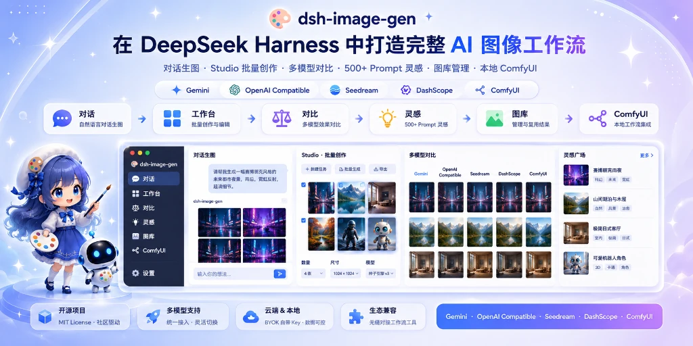

---

## 快速开始

### 1. 安装插件

环境要求：DeepSeek Harness 稳定版本，Node.js `^22.19.0` 或 `>= 24.0.0`。

在你的 DeepSeek Harness 项目根目录下运行：

```bash
pnpm dsh plugin --profile web add dsh-image-gen@latest
```

> 💬 **极客提示**：你也可以直接把这句话发送给 DSH 对话中的 Agent：<br />
> `帮我安装生图插件，在终端执行：pnpm dsh plugin --profile web add dsh-image-gen@latest`

<details>
<summary><strong>其他安装方式（全局 / GitHub 直装 / 本地调试）</strong></summary>

```bash
# 若已将 dsh 安装为系统全局命令：
dsh plugin --profile web add dsh-image-gen@latest

# 从 GitHub 仓库直接安装最新代码：
pnpm dsh plugin --profile web add git+https://github.com/shanliuling/dsh-image-gen.git

# 本地克隆源码开发安装：
git clone https://github.com/shanliuling/dsh-image-gen.git
pnpm dsh plugin --profile web add ./dsh-image-gen
```

</details>

### 2. 配置 Provider

重启 DSH 后，点击左侧边栏的 **「插件」** 图标打开插件面板，在 **「已安装」** 分区点击 **dsh-image-gen**，进入插件详情页即可看到「图像生成」配置表单：

**插件面板 → 已安装 → dsh-image-gen**

> DSH 0.1.5 及更早版本没有插件面板，入口仍为「设置 → 插件 → 插件配置 → 图像生成」；插件已同时兼容两种入口。

选择 Provider，填写自己的 API Key，并按需调整模型、Endpoint / Base URL 与工作区保存选项。填好 Key 后可点击**「测试连接」**验证可用性，或点击**「拉取模型」**一键获取该厂商支持的全部生图模型，无需手动查文档。使用 ComfyUI 时，请填写 DSH Host 可访问的服务地址，并导入 **API Format Workflow JSON**。

已有 ChatGPT、Grok 或 Google 订阅？无需填写 API Key：展开对应的订阅 Provider 行，点击**「登录」**并在浏览器完成授权，即可直接开始文生图与图生图。

<div align="center">
  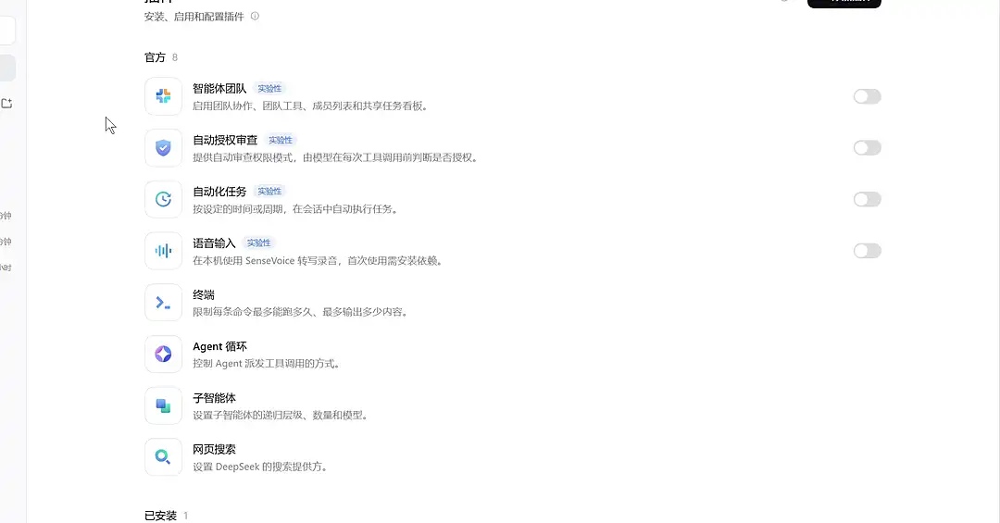
  <br />
  <sub>选默认 Provider → 查看各渠道的 Key / 登录状态 → 在对话输入框旁随手切换。</sub>
</div>

### 3. 开始创作

在聊天框中直接描述你想要的图片：

```text
画一张雨夜霓虹街头的赛博朋克猫咪，电影感光线，16:9。
```

想要一整组图？直接说数量和统一风格：

```text
给我的小红书笔记《周末露营清单》配 5 张图：帐篷、炉具、睡袋、照明、零食，统一日系手绘风，3:4。
```

也可以直接上传参考图，让 Agent 进行风格重构或局部编辑：

```text
保持角色与构图不变，给猫咪戴上一副黑色墨镜。
```

<br />

<div align="center">
  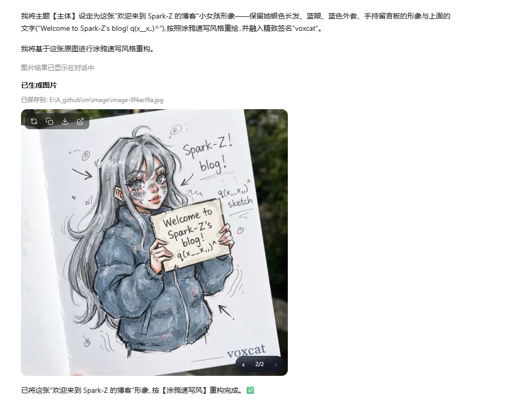
  <br />
  <sub>在对话中直接生图、图生图与连续编辑。</sub>
</div>

<br />

需要更细的参数控制时，点击会话顶部的 **画廊** 入口，进入 **图库 / 工作台 / 灵感 / 收藏**。

---

## 核心能力

<a id="chat-batch"></a>

### 🔁 对话批量生图：一句话，一整组图

配图、分镜、系列插画、同一主题的多个变体，不用一张一张地催。

- 用一句话描述数量和统一要求，Agent 会自己规划出一组 Prompt，**单次最多 10 张**，图片按顺序附在同一条回复里。
- 比例、清晰度、模型、Provider 可以对整组统一指定，保证风格一致。
- 逐张生成，**某一张失败不会影响其余图片**，最后会汇报「成功 X / 共 Y」并列出失败原因。
- 本地 ComfyUI 和订阅通道同样支持批量。

<div align="center">
  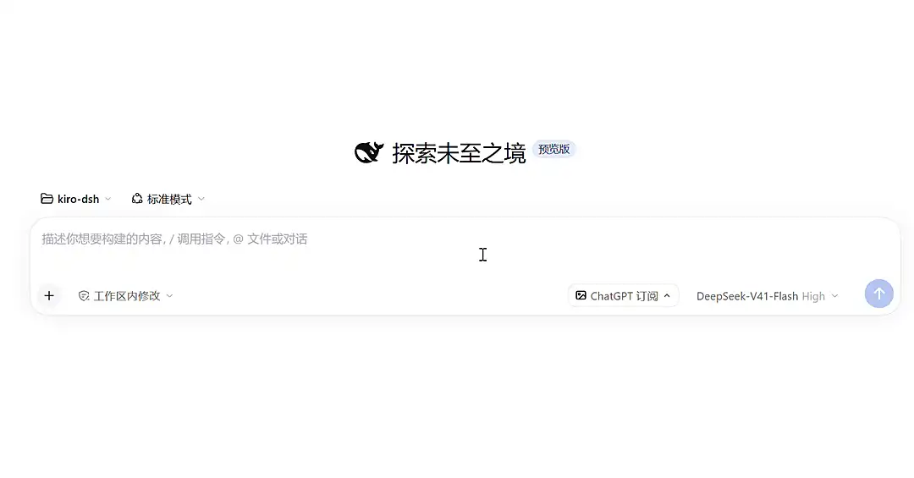
  <br />
  <sub>一条消息写 5 个画面 → Agent 规划成两批生成 → 逐张出图，失败的那张自动单独重跑 → 整组进入图库。（等待部分已加速）</sub>
</div>

> **对话批量和 Studio 批量有什么区别？** 对话批量是 Agent 帮你规划**一组不同的画面**（例如 4 张不同场景的插图）；Studio 批量是**同一个 Prompt 出多张候选**，由你挑选满意的保存。

<br />

<a id="ai-canvas"></a>

### ✏️ 看得懂草图的 AI 画布

在无限画布上画草图、摆参考图、圈出要改的地方，然后直接用对话告诉 AI 你想要什么。**Agent 能看到画布上的内容和你当前的选区**，不需要你截图、上传或者描述位置。

- **草图 → 成图**：随手画个轮廓，选中它说「画成卡通角色」。
- **圈哪改哪**：在已有图片上用画笔圈出局部，说「把这里换成斧头」，只改圈出的部分。
- **组合参考**：把「最近生成」或图库里的图拖进画布，或点击缩略图上的「发送到画布」，多张一起选中作为参考。同一张历史图片重复导入会自动去重。
- 每一步结果都留在画布上，随时可以从任意一版继续往下迭代。

<div align="center">
  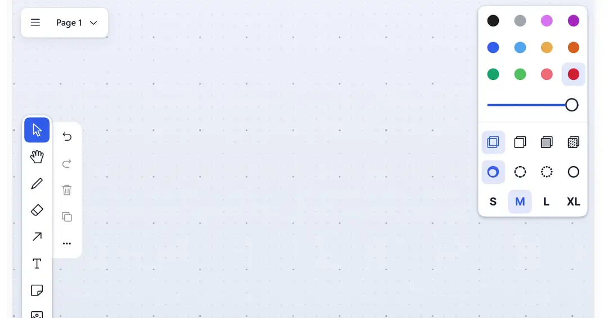
  <br />
  <sub><b>圈哪改哪</b>：圈出女剑士手里的剑，说「变成一把斧头」，Agent 先确认圈的是什么，再只改那一处。</sub>
  <br /><br />
  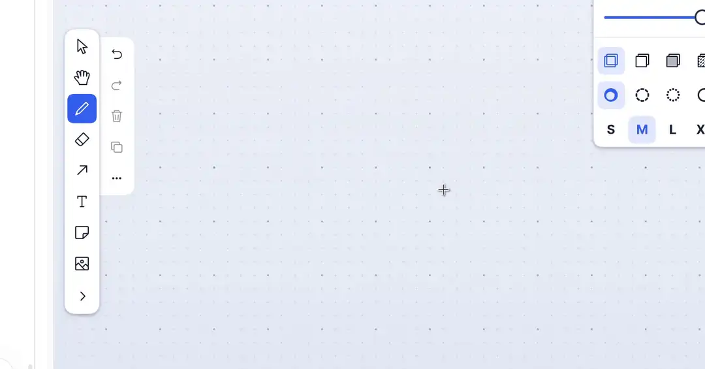
  <br />
  <sub><b>草图 → 成图</b>：随手画个持剑的火柴人，框选后说「按照之前风格生成」，姿势和构图都照着草图来。（等待部分已加速）</sub>
</div>

<br />

### 💬 对话生图、编辑与版本切换

- 用自然语言完成文生图、图生图、多图参考和风格迁移。
- **角色一致性**：要求「保持这个人物 / 角色 / 物体不变」时，插件会让模型沿用参考图里的同一主体，只改场景、服装、姿势或风格，而不是重新画一个相似的人。
- 直接修改原图 Prompt 重新生成，并在同一卡片中切换历史版本。
- 生成结果是 GIF 时，对话卡片直接播放动画：左下角调倍速（0.2×–2×），工具栏的下载菜单可按当前倍速或原速下载 GIF、或下载当前帧（PNG）；点开大图有播放键、逐帧缩略图时间轴（悬停预览、点击停在这一帧）和倍速。图库里的 GIF 带角标、悬停即播放，大图同样可播放与下载。GIF 文件可直接拖出，重新生成仍得到 GIF（剪贴板只支持静态图，复制得到的是单帧）。
- GIF 卡片右下角「编辑」（或大图播放条的「编辑帧」）可按帧写修改意见：在画面上点位置写评论，评论只显示在它所在的那一帧，也可切到「全部帧」一次看全；一次发送即按评论重绘整段，新结果作为新版本保留并会动（仅 OpenAI 与兼容渠道，且中转需支持图生图；不支持时可一键改为描述后重新生成）。

<br />

<div align="center">
  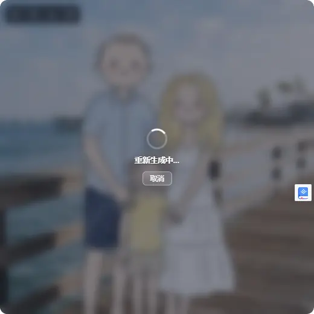
  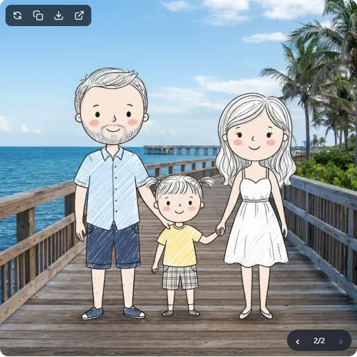
  <br />
  <sub>修改 Prompt 后原位重新生成，并在同一张图片卡片中切换历史版本。</sub>
</div>

<br />

### ✨ 500+ Prompt 灵感：Agent 会自己去找

内置手绘风格手册（风格 / 排版 / 单色主题色）和 awesome-gpt-image-2 案例集，共 500+ 个可直接复用的 Prompt。

- **在对话里直接点名**：说「用风格 #123」「做成信息图排版」「莫兰迪色系」，Agent 会先在灵感库里检索，再把模板套到你的主题上出图。风格、排版、主题色还可以组合使用。
- **在界面里浏览**：筛选、收藏、复制，或一键带入工作台（见下方 Studio 演示）。
- 图片缓存在本地，浏览和学习不消耗 Token 或生成额度。

<br />

<div align="center">
  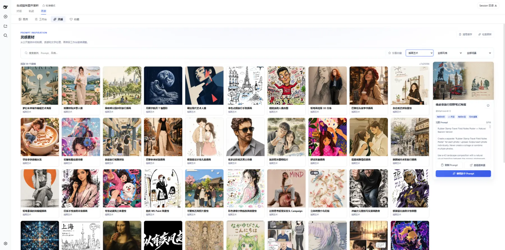
  <br />
  <sub>先找灵感，再把 Prompt 带入工作台；全本地缓存，浏览或复制不消耗生成额度。</sub>
</div>

<br />

### 🎛️ Studio 工作台：不用对话，自己调参数

想精细控制时，打开会话顶部的 **画廊 → 工作台**，所有参数都摆在面前。

- **从灵感直接开工**：在灵感库里点「带入工作台」，Prompt 自动填好。
- **参数一目了然**：Provider、模型、比例、生成质量、水印都能单独选；一次出 1–4 张候选，满意的才保存。
- **拿历史结果继续改**：从「最近生成」拖一张图进来，点「继续编辑（垫图）」，它就自动成为图生图的参考图（最多 5 张）。
- 单模型 / 多模型对比一键切换。

<br />

<div align="center">
  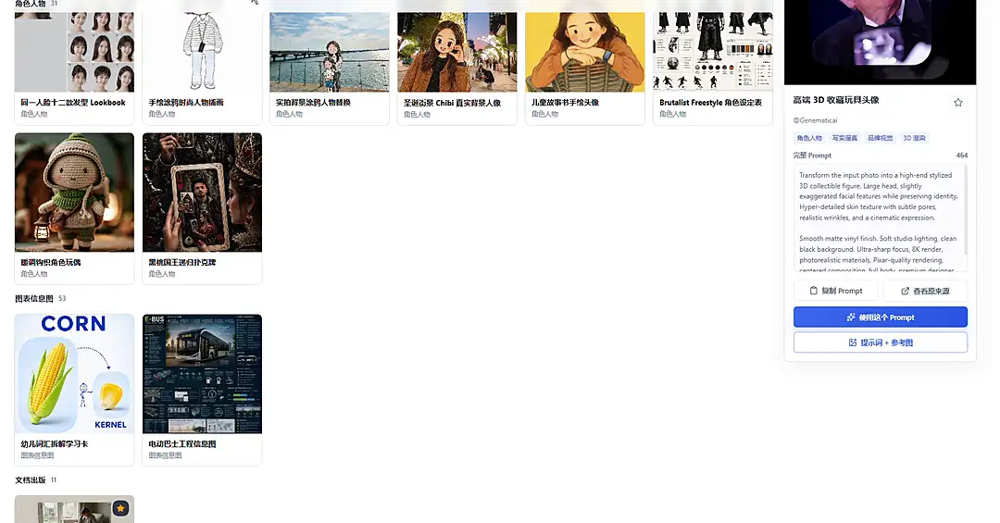
  <br />
  <sub>灵感库挑一个 Prompt → 带入工作台 → 选好参数开始生成 → 出图后再决定保存。（等待部分已加速）</sub>
  <br /><br />
  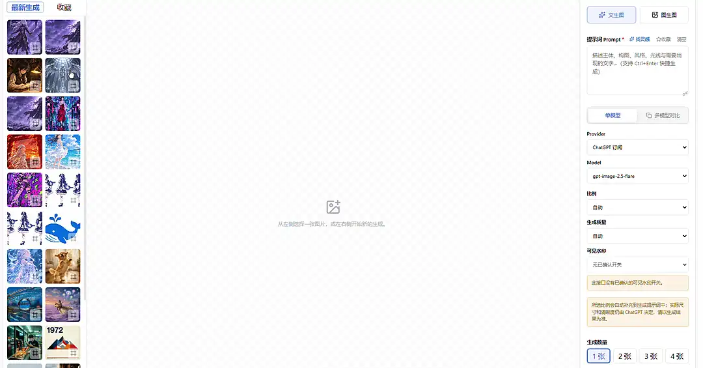
  <br />
  <sub>从「最近生成」拖一张图进来 → 「继续编辑（垫图）」→ 自动切到图生图，写一句要改什么就行。</sub>
</div>

<br />

### ⚖️ 多模型横向对比

使用同一组 Prompt 和参考图并发调用多个模型，在一张画布中比较并保存结果。

<br />

<div align="center">
  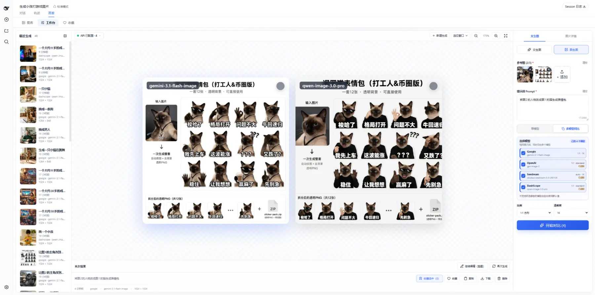
  <br />
  <sub>在同一画布中比较不同模型结果，再批量保存满意的图片。</sub>
</div>

<br />

### 🖼️ 图库、收藏与批量管理

- 统一管理对话和 Studio 中保存的图片，并按工作区隔离。
- 支持搜索、筛选、收藏、下载、继续编辑、重新生成和批量管理。

<br />

<div align="center">
  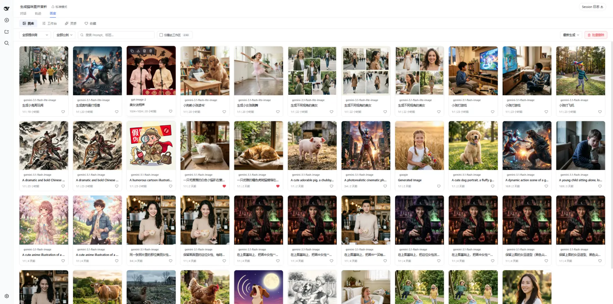
  <br />
  <sub>图库支持多维度筛选、收藏、批量管理与工作区数据隔离。</sub>
</div>

<br />

### 🧩 本地 ComfyUI 多工作流

灵活调用本地 GPU 算力，让私有化绘图无缝融入 Agent 对话。

- 导入并管理多个命名工作流，支持预设 Prompt 和常用占位符。
- Agent 可按名称选择工作流，在对话中完成文生图、图生图和批量生图。

> ComfyUI 暂未接入 Studio 和多模型对比。

<br />

<div align="center">
  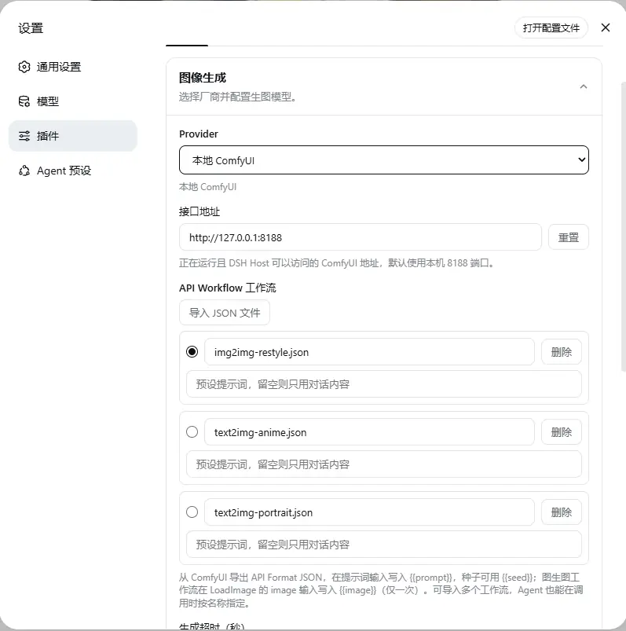
  <br />
  <sub>为不同用途维护独立工作流，并通过名称让 Agent 精确选择。</sub>
</div>

<br />

---

## Provider 支持情况

| Provider                          | 对话生图 | 对话批量 | 对话编辑 | Studio | 多模型对比 |
| :-------------------------------- | :------: | :------: | :------: | :----: | :--------: |
| **Google Gemini**                 |    ✅    |    ✅    | ✅ 多图  |   ✅   |     ✅     |
| **OpenAI Images**                 |    ✅    |    ✅    | ✅ 多图  |   ✅   |     ✅     |
| **OpenAI Compatible（中转站）**   |    ✅    |    ✅    | ✅ 多图  |   ✅   |     ✅     |
| **ByteDance Seedream / 火山方舟** |    ✅    |    ✅    | ✅ 多图  |   ✅   |     ✅     |
| **Aliyun DashScope / Qwen Image** |    ✅    |    ✅    | ✅ 多图  |   ✅   |     ✅     |
| **xAI Grok Imagine**              |    ✅    |    ✅    | ⚠️ 有限  |   ✅   |     ✅     |
| **智谱 GLM-Image**                |    ✅    |    ✅    |    —     |   ✅   |     ✅     |
| **Local ComfyUI**                 |    ✅    |    ✅    | ✅ 单图  |   —    |     —      |
| **ChatGPT 订阅（免 Key）**        |    ✅    |    ✅    | ✅ 多图  |   ✅   |     ✅     |
| **Grok 订阅（免 Key）**           |    ✅    |    ✅    | ✅ 多图  |   ✅   |     ✅     |
| **Google 订阅（免 Key）**         |    ✅    |    ✅    | ✅ 多图  |   ✅   |     ✅     |

> Studio 与多模型对比目前只支持云端 Provider（含订阅通道）；多模型对比调用的是各 Provider 在设置中已配置的模型。
> 智谱 GLM-Image 上游本身不支持图生图；xAI 图生图走 OpenAI 兼容协议（multipart），部分网关可能需等待后续适配。
> 订阅通道通过账号登录使用（免 API Key），图生图走各订阅渠道的编辑接口（最多 5 张参考图），比例与清晰度可在 Studio 中直接选择。
> OpenAI、兼容渠道与 ChatGPT 订阅的对话生图和图生图都可以直接要求输出 GIF 动图，例如把参考图里的角色做成动图（需模型与中转支持；图生图还要求中转支持改图接口），帧数、帧时长等参数见 [Provider 配置参考](docs/providers.md)。按帧编辑暂只支持 OpenAI 与兼容渠道。

📖 **默认模型与 Endpoint、各 Provider 的比例 / 清晰度、尺寸表、水印、中转站编辑格式等高级配置，见 [Provider 配置参考](docs/providers.md)。**

---

## 数据与隐私

- **BYOK**：API Key 通过 DSH Credentials 服务保存，设置页不会回显 Key 明文。
- **订阅登录**：订阅账号令牌经你授权登录后保存于 DSH Credentials，与 API Key 完全隔离，浏览器侧不接触令牌。
- **云端请求**：Prompt 与本次使用的参考图会发送给所选 Provider，请遵守对应服务条款。
- **上游图片下载**：沿用宿主已有的网络和代理配置，不额外拦截 Fake-IP、内网或回环地址。当前未提供完整的 SSRF 目标限制。
- **本地 ComfyUI**：请求发送到用户配置的 ComfyUI 地址。
- **工作区文件**：开启工作区保存后，对话结果会落盘；Studio 仅保存用户选中的候选图。
- **GIF 原图**：动图结果的原始文件另存于原图保险库（`vaultEnabled` 可关闭），供卡片播放与导出，随图库删除一并清理。
- **图库与收藏**：图库元数据和收藏状态保存在当前浏览器本地存储中。
- **删除记录**：普通删除会保留轻量的图片 ID 标记，超过 30 天也不会因重新打开旧会话而自动恢复到图库。
- **灵感缓存**：案例元数据随插件提供，图片按需加载并缓存在本机，可随时清理。

## 常见问题

<details>
<summary><strong>安装后找不到“图像生成”设置怎么办？</strong></summary>

设置入口随 DSH 版本不同：0.1.6 及以上位于插件详情页（点击左侧边栏「插件」图标，在「已安装」分区进入 dsh-image-gen），0.1.5 及更早位于「设置 → 插件 → 插件配置 → 图像生成」。

若两处都没有，先完全重启当前 DSH Profile，再检查插件配置：

```bash
dsh --profile web --dump-config
```

如果输出中没有 `dsh-image-gen`，请重新执行安装命令。提交 Issue 时请附 DSH 版本、插件版本和错误日志，不要上传 API Key。

</details>

<details>
<summary><strong>一次最多能批量生成多少张？</strong></summary>

对话批量单次调用最多 10 张，超过时插件会提示 Agent 拆成多次调用。图片是逐张生成的，单张失败不会中断其余图片，失败的会在结果里单独列出原因。

</details>

<details>
<summary><strong>生成图片保存在哪里？</strong></summary>

开启“保存到工作区”后，对话生成结果默认保存在当前工作区的 `dsh-image-gen/` 子目录，也可以在设置中修改。Studio 候选图先留在临时画布，只有用户选中的结果才会进入图库并保存。

</details>

<details>
<summary><strong>Gemini 中转只支持 generateContent，如何配置？</strong></summary>

在 Google Gemini 设置中，将“请求协议”改为“原生 generateContent”，接口地址填写中转的 API 基础地址，例如 `https://your-relay.example/v1beta`，保存后即可用于对话生图、图生图和 Studio。已有的 Interactions 完整地址也可以沿用，插件会按所选模型构建原生请求地址。

配置文件对应 `googleNative: true`；默认值为 `false`，现有用户仍使用 Interactions 协议。

</details>

<details>
<summary><strong>为什么 ComfyUI 没有出现在 Studio 中？</strong></summary>

当前 Studio 与多模型对比仅支持云端 Provider，暂未接入 ComfyUI。ComfyUI 已支持在 Agent 对话中进行文生图、单图编辑、批量生图以及多个命名工作流。

</details>

<details>
<summary><strong>从图库删除会删除聊天记录吗？</strong></summary>

不会。删除图库记录不会修改原聊天消息。你可以额外选择是否清理工作区中的本地图片文件；文件删除通常无法恢复，请确认后操作。

</details>

<details>
<summary><strong>如何升级？</strong></summary>

```bash
pnpm dsh plugin --profile web add dsh-image-gen@latest
```

升级后重启对应的 DSH Profile。

</details>

---

## 本地开发

```bash
git clone https://github.com/shanliuling/dsh-image-gen.git
cd dsh-image-gen

pnpm install
pnpm run typecheck
pnpm test
pnpm run build
pnpm run pack:check
pnpm run test:package
```

依赖要求与 `test:package` 的测试范围等维护者说明见 [CONTRIBUTING.md](CONTRIBUTING.md)。欢迎通过 [Issues](https://github.com/shanliuling/dsh-image-gen/issues) 反馈问题，或阅读贡献指南后提交 Pull Request。

## 鸣谢

- [AtomGit](https://atomgit.com/shanliuling/dsh-image-gen)：为本项目提供国内代码托管，方便国内用户访问与获取源码。

## License

本项目基于 [Apache License 2.0](LICENSE) 开源。

<div align="center">

如果 `dsh-image-gen` 对你的工作流有所帮助，欢迎在 GitHub 点亮一颗 ⭐ **Star** 支持持续维护。

**[查看 Releases](https://github.com/shanliuling/dsh-image-gen/releases) · [提交 Issue](https://github.com/shanliuling/dsh-image-gen/issues) · [参与贡献](CONTRIBUTING.md)**

</div>
